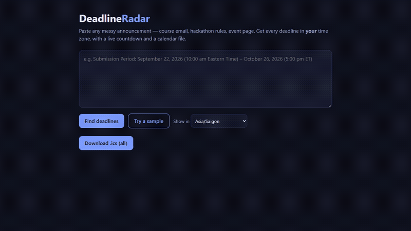
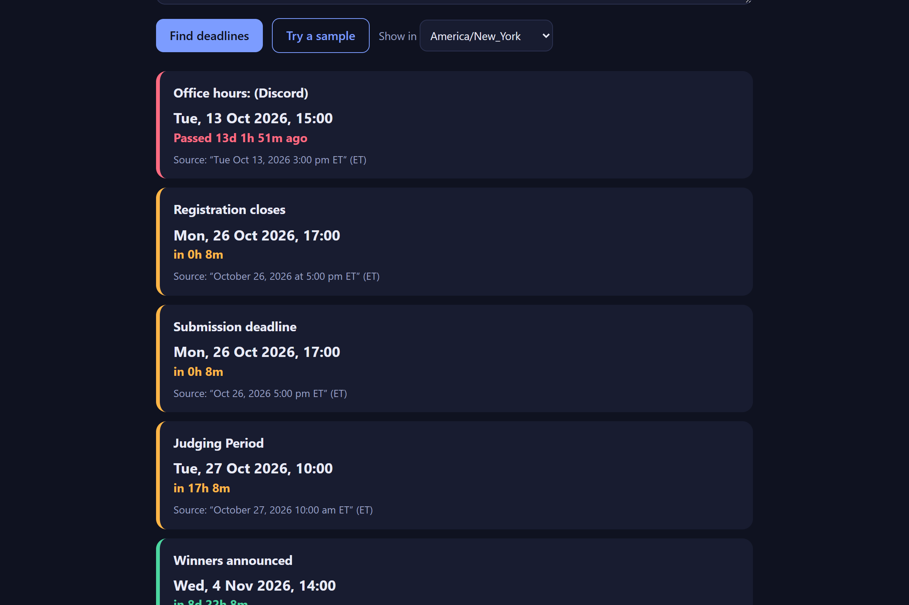
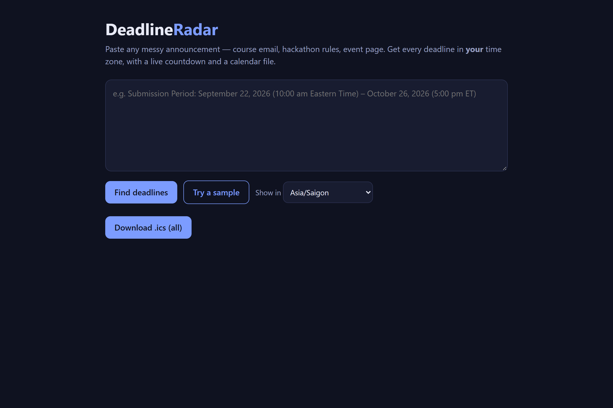
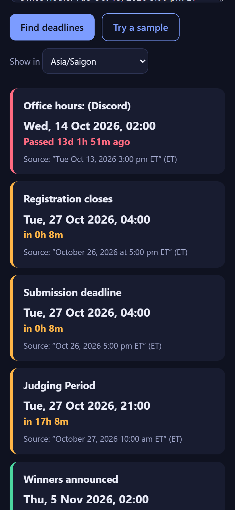
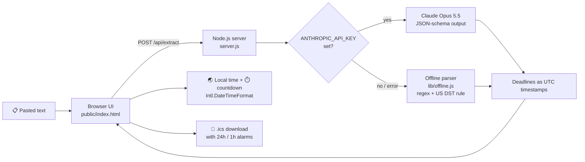

<p align="center">
  
</p>

<p align="center">
  <b>Paste any messy announcement → see every deadline in your own time zone, with a live countdown and a calendar file.</b>
</p>

<p align="center">
  <a href="https://youtu.be/3uq9ODZYJcI"></a>
  
  
  
  
  <a href="LICENSE"></a>
  
</p>

---

## 🎬 Demo

<p align="center">
  
</p>

<p align="center">
  <a href="https://youtu.be/3uq9ODZYJcI">
    
  </a>
  <br>
  <sub>▶ Full 70-second demo with narration on YouTube · <a href="docs/demo.mp4">download MP4</a></sub>
</p>

## 😩 The problem

International students constantly read rules like:

> *"Submission closes **October 26, 5:00 pm ET**"*

For a student in Vietnam that is actually **4:00 am on October 27**, and daylight saving makes it even easier to get wrong ("ET" is UTC-4 in October but UTC-5 in November). Missing a deadline by a few hours can cost a scholarship, an application, or a hackathon entry.

## ✨ Features

| | Feature | Details |
|---|---|---|
| 🔍 | **Smart extraction** | Finds every deadline/event in pasted text. Uses Claude structured output, or an offline parser when no key is set |
| 🌏 | **Any time zone** | Converts to your browser's zone or any zone you pick, with correct US daylight-saving handling |
| ⏱️ | **Live countdown** | Color-coded: 🔴 passed · 🟠 under 48h · 🟢 upcoming. Refreshes every 30s |
| 🧾 | **Verifiable** | Shows the original quoted phrase next to every result |
| 📅 | **Calendar export** | One-click `.ics` file with reminders 24h and 1h before each deadline |
| 📱 | **Responsive** | Works on desktop and mobile |

## 📸 Screenshots

| Deadlines in Vietnam time | Same deadlines in New York time |
|---|---|
|  |  |

| Home | Mobile |
|---|---|
|  |  |

## 🏗️ How it works



- The **server** only turns text into a list of `{ title, datetime_utc, source_timezone, quote }`.
- The **browser** does all time-zone formatting, countdowns and `.ics` generation, so switching zones is instant.
- If Claude is unavailable for any reason, the app silently falls back to the offline parser, so it **always works**.

## 🚀 Quick start

Requires **Node.js 18+**.

```bash
git clone https://github.com/AIVIETNAM-AIO-felixdoit/deadlineradar.git
cd deadlineradar
npm install
npm start
```

Open **http://localhost:3000** and click **Try a sample**.

### Optional: AI mode

Claude handles unusual date formats and context better than the offline parser.

```bash
# PowerShell
$env:ANTHROPIC_API_KEY="sk-ant-..."; npm start

# macOS / Linux
ANTHROPIC_API_KEY=sk-ant-... npm start
```

The footer under the results shows which engine was used.

## 📁 Project structure

```
deadlineradar/
├── server.js            # HTTP server + /api/extract (Claude or offline)
├── lib/offline.js       # Rule-based parser with US daylight-saving rule
├── public/index.html    # UI, countdowns, time-zone switch, .ics export
├── devpost/             # Planning docs from the Devpost Learn Skill Pack
│   ├── scope.md
│   ├── prd.md
│   └── spec.md
└── docs/                # Banner, screenshots, demo video
```

## 🧠 Planning

Planned with the **Devpost Learn Skill Pack** before building:

- [`scope.md`](devpost/scope.md): unique kernel, core loop, POC boundary
- [`prd.md`](devpost/prd.md): core journey, behaviors, states and edge cases
- [`spec.md`](devpost/spec.md): stack, components, data model, failure modes

## 🗺️ Roadmap

- [ ] Browser extension that highlights deadlines on any page
- [ ] Email-forwarding inbox ("forward the email, get the calendar")
- [ ] Reminders via chat apps
- [ ] Smarter offline handling of ambiguous numeric dates (03/04)

## 🛠️ Built with

Node.js · `@anthropic-ai/sdk` · Vanilla HTML/CSS/JS · `Intl.DateTimeFormat` · iCalendar (`.ics`)

Built with Claude Code as the coding agent and the Devpost Learn Skill Pack. No other pre-existing code.

## 📄 License

[MIT](LICENSE)
